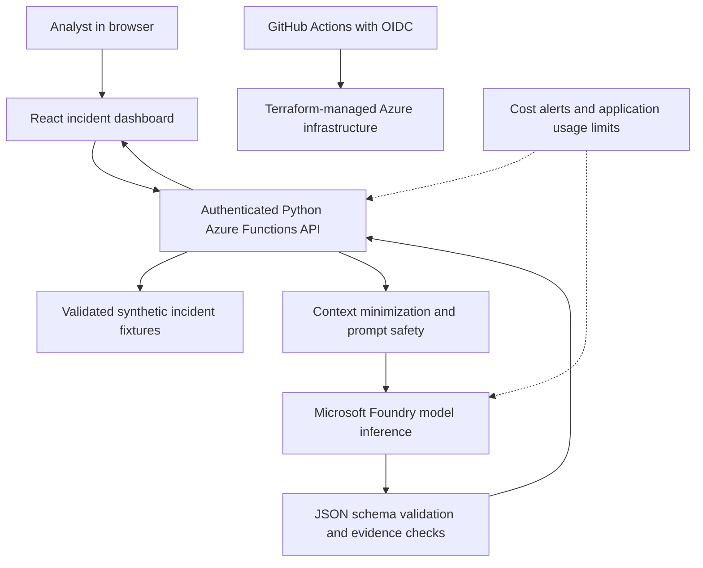

# CloudGenius Azure AI Security Copilot
### Real-Time Security Incident Investigation with Microsoft Foundry

**Status:** Architecture and prerequisite verification complete; implementation and deployments pending.  
**Environment:** Azure Dev subscription · West US 3 (Arizona) · USD 5/month cost-alert budget.  
**Repository:** `globalcloudgenius/doings-foundry-sentinel-copilot`

## Executive summary

CloudGenius Azure AI Security Copilot is an **enterprise-inspired, human-in-the-loop security operations lab** designed to demonstrate responsible use of generative AI in incident investigation. The planned solution combines synthetic Microsoft Sentinel-style incidents, a Python investigation API, a React analyst dashboard, and real hosted inference through Microsoft Foundry. Infrastructure will be defined with Terraform and deployed through GitHub Actions with workload identity federation (OIDC).

The application is intended to turn structured security incident evidence into **analyst-reviewable summaries, observed indicators, hypotheses, and prioritized investigation recommendations**. The model does not independently verify that a threat occurred and will not autonomously remediate or alter Azure/Microsoft security resources.

> **Transparency:** The current repository contains the project plan and verified environment-preparation records, **not a deployed AI security application**. “Real-time” in the project title describes the intended on-demand inference interaction after implementation, **not continuous live Microsoft Sentinel monitoring**. The first release will use synthetic local data rather than an active Sentinel connector.

## Problem statement

Security operations teams handle incident records that can contain numerous alerts, identities, endpoints, timestamps, observables and detection details. Analysts must understand evidence quickly, distinguish established facts from hypotheses, and plan consistent next steps. This project explores how a low-cost, securely integrated LLM can accelerate the *interpretation* of this information without replacing analyst judgment.

## Objectives

1. Build an interactive incident analysis interface and reproducible synthetic incident data.
2. Invoke a real Microsoft Foundry language-model deployment from a secure, authenticated backend.
3. Produce evidence-grounded structured analysis while expressing uncertainty.
4. Apply cloud-security and DevSecOps controls: managed identity when supported, OIDC, least privilege, secrets hygiene, validation and auditing.
5. Manage Azure infrastructure with Terraform and controlled GitHub Actions workflows.
6. Demonstrate cost-aware AI experimentation under a USD 5 **alert** budget, with additional usage constraints and explicit spend monitoring.

## Target capabilities (planned)

| Capability | Description |
|---|---|
| Incident browser | Search, filter and inspect synthetic Sentinel-style incidents |
| On-demand AI investigation | User-triggered Foundry model inference for an incident |
| Evidence-aware summary | Distinguish source observations from generated hypotheses |
| Triage assistance | Provide likely investigative priorities and suggested queries/checks |
| Structured recommendations | Produce human-reviewable next steps; no automatic blocking or remediation |
| Operational controls | Input validation, schema-checked output, authentication, limits, safe errors |
| Cost governance | Monitor usage, enforce application limits, and use Azure budget alerting |
| DevSecOps | Terraform, GitHub Actions, OIDC, scans, approvals and auditability |
| Optional future Sentinel link | Read-only, least-privilege integration after MVP validation |

## Logical architecture

**Regional preference:** Use `westus3` for provisioned Azure resources where supported. Model request processing location depends on deployment SKU (for example, Global Standard or Data Zone Standard) and must be separately verified. Azure region selection alone does not guarantee inference is physically processed in Phoenix.

## Planned implementation

- **Frontend:** React with readable incident list/detail and evidence-linked results.
- **Backend:** Python on Azure Functions with authenticated endpoints and structured responses.
- **AI:** Microsoft Foundry with a cost-conscious supported model; `gpt-4.1-nano` is a candidate, **not a deployed model**.
- **Incident dataset:** Version-controlled synthetic JSON, no live Microsoft Sentinel ingest.
- **Infrastructure:** Terraform with secure remote state, explicit tags and least-privilege role assignments.
- **CI/CD:** GitHub Actions, federated Azure sign-in, PR plan checks and approval-gated applies.
- **Security:** Server-side model access, request limits, redaction, safe rendering and human approval.

Actual hosting tiers, inference deployment options and costs will be approved after quota and current-price checks.

## Current Azure prerequisite verification (2026-10-11)

| Check | Observed status |
|---|---|
| Azure subscription `Dev` | **Verified enabled** |
| Primary region `westus3` | **Verified present** |
| Admin's direct subscription-level Owner RBAC | **Verified** |
| Azure CLI / Terraform (v1.16.4 in Cloud Shell) | **Verified** |
| `Microsoft.CognitiveServices`, `Microsoft.Web`, `Microsoft.Storage`, `Microsoft.ManagedIdentity`, `Microsoft.Insights` | **Registered** |
| Monthly Azure budget | **Configured at USD 5** with 60/80/90/100% email alerts |
| Candidate GPT-4.1-nano, GPT-4.1-mini, GPT-4o-mini catalog listings | **Returned for West US 3** |
| Positive available quota for selected inference deployment | **Not yet confirmed** |
| OIDC deployment identity / Terraform state / hosted app | **Not yet deployed** |

See [the evidence-backed prerequisite register](docs/PREREQUISITES.md) for details. No currently visible resource inventory was returned by the supplied inspection command.

### Cost and deployment disclaimer

A USD 5 Azure budget is **not** a spending cap and cannot guarantee a maximum bill. Billing data may lag. Model quotas, runtime hosting and request volume must be reviewed independently. The application will be designed to minimize requests and have a practical manual shutoff procedure.

## Documentation

| Document | Purpose |
|---|---|
| [Prerequisites & verification](docs/PREREQUISITES.md) | Verified Azure setup and open gates |
| [Architecture & functions](docs/ARCHITECTURE.md) | Components, workflow, APIs, scope and tests |
| [Security & cost controls](docs/SECURITY-AND-COST.md) | Threat boundaries, RBAC, safe AI usage and spend policies |
| [Implementation roadmap](docs/ROADMAP.md) | Phases, checklists and acceptance criteria |

## Delivery plan

1. **Foundation:** Confirm deployment quota and repository governance, establish GitHub OIDC, least-privilege Azure roles and secure Terraform remote state.
2. **Infrastructure:** Review and approve model SKU and web hosting costs; provision necessary resources via Terraform.
3. **Application:** Implement synthetic incidents, API, frontend and grounded LLM investigations.
4. **Validation:** Run functionality, authentication, injection, usage-control and recovery tests.
5. **Demonstration:** Document reproducible walkthrough and measured limitations; consider live, read-only Sentinel integration separately.

## Safety and limitations

This is a learning and portfolio project, not a certified SOC product. LLM summaries can be incorrect or incomplete; all suggested actions require analyst verification. No real customer telemetry should be submitted in the initial release. The project does not require Microsoft 365 E5, a purchased domain, AKS, dedicated GPUs or a production Sentinel deployment for its MVP.

## Project identity

**CloudGenius Azure AI Security Copilot — Real-Time Security Incident Investigation with Microsoft Foundry**

A professional, cost-aware Azure AI and cloud-security engineering demonstration: **real hosted inference, synthetic evidence, human-reviewed conclusions, and reproducible secure deployment**.
