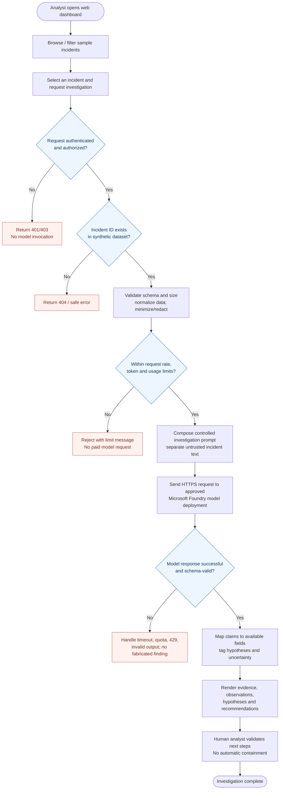

# Logical incident investigation flow — proposed MVP

> **On-demand incident analysis**, not continuous live ingestion or automatic remediation. All incidents in v1 are synthetic examples.

## Logic and evidence handling

| Stage | Intended behavior |
|---|---|
| View | Show sample data clearly marked synthetic, not real SOC detections |
| Authentication | Deny unauthenticated/unauthorized access to incident endpoints |
| Input | Use canonical server-held incident data, not blindly trusted browser-supplied incident text |
| AI prompt | Treat incident details and observables as untrusted input, never executable instructions |
| Model request | Bound timeouts, response tokens, request frequency and daily call allowance |
| Model response | Validate a strict output schema; never present hallucinated evidence as observed telemetry |
| Evidence | Distinguish input-supported observations from generated hypotheses and suggestions |
| Response | Return a consistent API shape and safe error messages |
| Analyst | Human makes investigation/containment decisions; platform does not act autonomously |

The project title uses **Real-Time** to indicate eventual on-demand model responses when a user submits an investigation. The first release does not subscribe to live Sentinel signals and does not guarantee instantaneous results.

## Future integration (not MVP)

A read-only Microsoft Sentinel connector can be added later, guarded by separate authorization, query constraints, paging, data protection and audit controls. It is not represented as an existing data source in this diagram.
