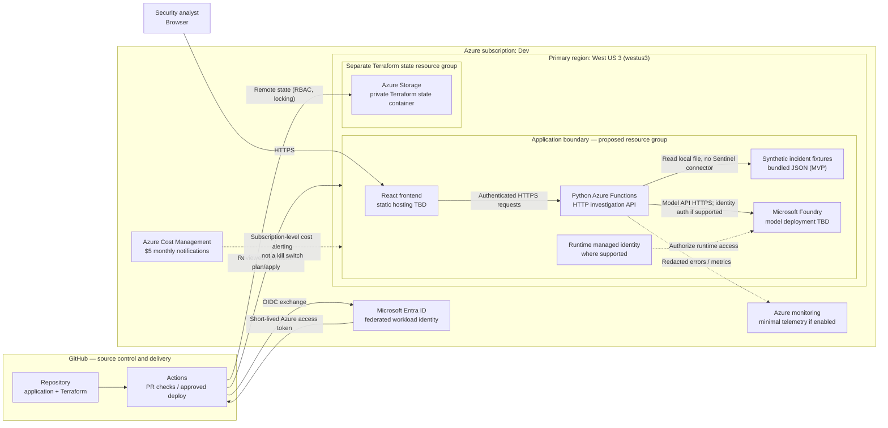

# Azure solution architecture — proposed MVP

> **Design, not deployed infrastructure.** The only verified Azure setup so far is the Dev subscription, $5 budget alerts, registered providers, Owner administrative role, region catalog and CLI tooling. Model deployment quota and hosting SKU are not approved.

## Boundaries and key decisions

1. The frontend calls the authenticated API. **It never calls the model directly and must not contain model API keys**.
2. The MVP dataset is versioned, **synthetic incident JSON bundled with the application**, not a paid Sentinel workspace or separate runtime storage service.
3. Terraform state is stored in a **separate dedicated Storage account/container**, not the same application-data resource. Actual Terraform backend creation remains pending.
4. GitHub Actions exchanges an OIDC token with Microsoft Entra ID to obtain short-lived Azure credentials. The separate GitHub deployment principal receives only required roles; it is **not** the subscription Owner.
5. Runtime identity to Foundry is a *design preference contingent on supported authentication* for the selected endpoint. Do not assume every Foundry model endpoint supports managed-identity auth.
6. The `westus3` boundary identifies planned *Azure resource location*, **not necessarily model inference processing location** for Global or Data Zone inference.
7. Monitoring and application hosting selections require explicit price review; the Azure $5 budget does not cap spending.
8. Static frontend hosting and API may reside in different Azure resource groups/services after a reviewed cost/hosting decision; the box is conceptual, not a claim that every resource has already been created.

## Interpretation

**Solid arrows** are planned requests or deployment/auth flows. **Dashed arrows** are supporting security, monitoring or governance associations. No automated remediation, production Sentinel feed, VNet, Key Vault, Application Gateway, private endpoint or expensive always-on compute is assumed in the MVP.

See [logical investigation flow](LOGICAL-INVESTIGATION-FLOW.md), [detailed architecture](../ARCHITECTURE.md), and [prerequisites](../PREREQUISITES.md).
